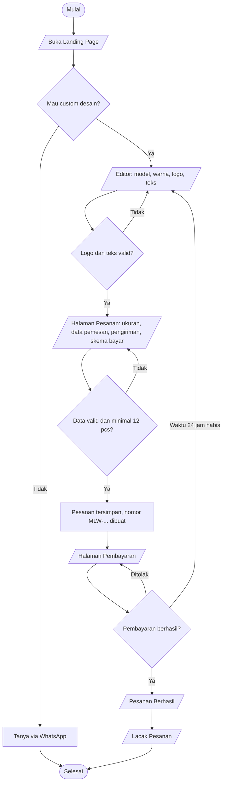
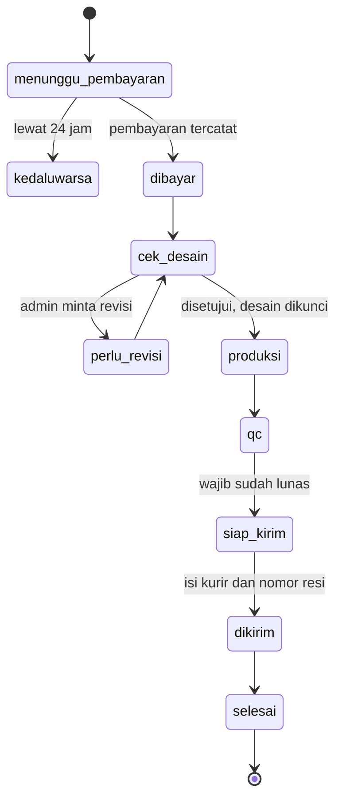

<div align="center">
  
# 🧵 MULAWARMANESIA

<a href="https://github.com/rramaaare/mulawarmanesia">
  
</a>

<br/>


**Website profil bisnis + kustomisasi dan pemesanan seragam PDH & VEST**
*Digital Innovation for Local Impact*

</div>

---

## 📚 Daftar Isi

- [📌 Deskripsi Website](#-deskripsi-website)
- [🎯 Tujuan Pengembangan](#-tujuan-pengembangan)
- [⚙️ Fitur Utama](#️-fitur-utama)
- [🔐 Peran dan Hak Akses](#-peran-dan-hak-akses)
- [🧰 Teknologi yang Digunakan](#-teknologi-yang-digunakan)
- [🧭 Perancangan Sistem](#-perancangan-sistem)
- [🚀 Cara Menjalankan Proyek](#-cara-menjalankan-proyek)
- [🩹 Troubleshooting](#-troubleshooting)
- [📁 Struktur Proyek](#-struktur-proyek)
- [🛡️ Integritas Data (ACID)](#️-integritas-data-acid)
- [📝 Catatan Demo](#-catatan-demo)
- [👥 Anggota Tim](#-anggota-tim)
- [🙏 Atribusi](#-atribusi)

---

## 📌 Deskripsi Website

**MULAWARMANESIA** adalah website untuk vendor konveksi di **Samarinda, Kalimantan Timur** yang melayani pembuatan seragam **PDH** dan **VEST**. Selain sebagai profil bisnis, website ini membuat pelanggan bisa **mendesain seragam sendiri**, **memesan**, **membayar**, dan **melacak pesanan** tanpa harus bolak-balik chat.

Selama ini pesan seragam di UMKM konveksi biasanya lewat WhatsApp: tanya model, kirim contoh gambar, tawar-menawar, transfer manual, lalu menunggu tanpa kabar. Website ini mengubah proses itu jadi alur yang jelas dan bisa dijalankan sendiri oleh pelanggan, sementara pemilik usaha mendapat panel untuk mengelola pesanan dan produksi.

> Dibuat untuk **Lomba Pengembangan Website FUAD FAIR 2026** (UINSI Samarinda)
> Tema: *Digital Innovation for Local Impact* · Kategori: **Local Business Innovation** (Bisnis dan UMKM)

Pengguna website ini ada tiga:

| Pengguna | Yang bisa dilakukan |
|---|---|
| 🧑 **Pelanggan** | Lihat produk, buat desain, pesan, bayar, dan lacak pesanan. Tidak perlu login. |
| 👷 **Admin** | Lihat dashboard, kelola pesanan, ubah status produksi, ekspor CSV. |
| 🛠️ **Superadmin** | Semua hak admin, ditambah master data, akun admin, pengaturan, dan log aktivitas. |

---

## 🎯 Tujuan Pengembangan

a. Mempermudah pelanggan memesan seragam tanpa harus chat berulang kali.

b. Membuat proses pemesanan lebih jelas, mulai dari desain, harga, pembayaran, sampai pengiriman.

c. Membantu vendor konveksi mengelola pesanan dan produksi dalam satu tempat.

d. Mengurangi salah paham soal desain, ukuran, dan harga karena semuanya tercatat di sistem.

e. Mendukung UMKM lokal agar lebih siap bersaing lewat pemanfaatan teknologi digital.

---

## ⚙️ Fitur Utama

### 🧑 Fitur untuk Pelanggan

**1. Landing Page**

Halaman awal berisi profil usaha, produk PDH & VEST, cara pesan, portofolio, dan testimoni, lengkap dengan efek paralaks. Ada juga halaman **Panduan Ukuran** untuk membantu memilih ukuran yang pas.

**2. Editor Desain**

Pelanggan bisa membuat desain seragam langsung di browser:
- Pilih model (PDH atau VEST), kategori desain, dan bahan
- Atur warna tiap bagian pakaian
- Unggah logo (posisi, ukuran, teknik bordir atau sablon)
- Tambah teks nama atau instansi
- Lihat tampak depan dan belakang, plus undo/redo dan zoom
- Draf tersimpan otomatis di browser, jadi tidak hilang kalau tab ditutup

**3. Halaman Pesanan**

Isi ukuran dan jumlah (bisa pakai nama per orang), data pemesan, pengiriman (kirim ke alamat atau ambil di workshop), lalu pilih bayar **Lunas** atau **DP 50%**. Minimal total pesanan **12 pcs**, dan harga dihitung otomatis termasuk diskon volume.

**4. Pembayaran**

Pilih metode QRIS, Virtual Account, atau e-wallet lewat payment gateway. Pada versi demo dipakai simulator gateway. Pesanan yang tidak dibayar dalam **24 jam** kedaluwarsa otomatis.

**5. Lacak Pesanan**

Cek status pakai nomor pesanan dan nomor WhatsApp, lengkap dengan timeline 8 tahap. Pelanggan juga bisa melihat alasan revisi jika desainnya diminta diperbaiki.

### 👷 Fitur untuk Admin

**1. Dashboard**

Ringkasan pesanan dan pendapatan, tren penjualan, kategori dan ukuran terlaris, kapasitas produksi, konversi, dan warna kain yang paling laku.

**2. Kelola Pesanan**

Lihat daftar pesanan dengan pencarian dan filter status, buka detail desain dan unduh file logo, ubah status produksi, minta revisi ke pelanggan, cetak **lembar produksi** satu halaman untuk workshop, dan ekspor data ke CSV.

**3. Produksi**

Antrean kerja workshop: pesanan yang sedang diproduksi, di tahap QC, dan siap kirim, lengkap dengan total pcs tiap tahap.

### 🛠️ Fitur Tambahan Superadmin

**🗂️ Master Data**

Atur harga dasar, biaya dekorasi, palet warna dan stok kain (bisa tambah warna baru), serta tarif ongkir.

**👤 Akun Admin**

Tambah akun (pilih peran Admin atau Superadmin), nonaktifkan atau aktifkan akun, dan reset kata sandi. Superadmin tidak bisa menonaktifkan dirinya sendiri, dan harus selalu ada minimal satu superadmin aktif.

**⚙️ Pengaturan**

Atur kapasitas produksi mingguan dan batas waktu bayar pesanan baru.

**📜 Log Aktivitas**

Catatan perubahan harga, biaya, stok, ongkir, akun, pengaturan, dan status pesanan.

---

## 🔐 Peran dan Hak Akses

Admin dan Superadmin **masuk lewat form login yang sama** (`/admin/login`). Peran dibaca dari akun di database, lalu menentukan dashboard dan menu yang tampil.

| Menu | 👷 Admin | 🛠️ Superadmin |
|---|:---:|:---:|
| Dashboard (ringkasan pesanan, pendapatan, kapasitas) | ✅ | ✅ |
| Dashboard bagian **Sistem** (akun, stok warna, aktivitas terbaru) | ❌ | ✅ |
| Pesanan (daftar, detail, ubah status, ekspor CSV, lembar produksi) | ✅ | ✅ |
| Produksi | ✅ | ✅ |
| Master data | ❌ | ✅ |
| Akun admin | ❌ | ✅ |
| Pengaturan | ❌ | ✅ |
| Log aktivitas | ❌ | ✅ |

Pembatasan ini dijaga di **server** pada setiap permintaan, bukan hanya disembunyikan di menu. Admin biasa yang membuka halaman superadmin lewat alamat langsung akan dikembalikan ke dashboard, dan permintaan API-nya ditolak dengan kode 403.

---

## 🧰 Teknologi yang Digunakan

| Bagian | Teknologi | Fungsi |
|---|---|---|
| Kerangka | **Next.js 16** (App Router) + **React 19** + **TypeScript 5** | Halaman web dan API dalam satu proyek |
| Tampilan | **Tailwind CSS 4**, font **Poppins**, gaya neo-brutalism | Desain antarmuka |
| Database | **MySQL 8** (InnoDB) lewat **Prisma ORM 7** dengan driver `mariadb` | Menyimpan data pesanan, harga, dan akun |
| Validasi | **Zod 4** | Satu aturan validasi untuk browser dan server |
| Animasi | **GSAP** (ScrollTrigger) | Efek paralaks di landing page |
| Grafik | **Recharts** | Grafik di dashboard admin |
| Pembayaran | **qrcode.react** + simulator gateway buatan sendiri | Menampilkan QR dan menjalankan alur bayar demo |
| Keamanan | **bcryptjs** + cookie login bertanda tangan HMAC | Login admin dan superadmin |
| Pengujian | **Vitest 5** | Tes domain, ACID, dashboard, dan superadmin |
| Peralatan dev | **ESLint 9**, **tsx**, **dotenv** | Cek kode, menjalankan seed, membaca `.env` |
| Pendukung | Laragon, Git & GitHub, draw.io, FigCraft | Database lokal, versi kode, diagram, dan desain UI |

---

## 🧭 Perancangan Sistem

Flowchart lengkap semua halaman (pelanggan, login admin dan superadmin, dashboard admin, dashboard superadmin, kelola pesanan, master data) ada di [app.diagrams.net](https://app.diagrams.net/).

### 🔄 Alur Pemesanan Pelanggan



### 🏷️ Status Pesanan

Status hanya boleh maju satu tahap. Satu-satunya yang boleh bolak-balik adalah **Cek desain** dan **Perlu revisi**.



---
### 📐 Alur Kode

```
Browser (pelanggan)
   │  membuka halaman / mengisi form
   ▼
app/<halaman>/page.tsx        ← halaman (Server Component)
   ▼
features/<fitur>/*.tsx        ← komponen interaktif ("use client")
   │  fetch("/api/...")
   ▼
app/api/<endpoint>/route.ts   ← pintu API (tipis, hanya memanggil service)
   ▼
server/services/*.ts          ← logika + transaksi database
   │            ▲
   │            └── lib/domain/*.ts  aturan murni (harga, status)
   ▼
Prisma → MySQL
```

---

## 🚀 Cara Menjalankan Proyek

### 1️⃣ Yang Perlu Disiapkan

- **Node.js 22.12** atau lebih baru (cek dengan `node -v`). Versi 20 tidak cukup karena Vitest 5 butuh Node 22.12+.
- **MySQL 8** (paling mudah lewat [Laragon](https://laragon.org/)). Pastikan servernya sudah menyala.
- **Git**

### 2️⃣ Langkah-langkah

**1. Unduh proyek**

```bash
git clone https://github.com/rramaaare/mulawarmanesia.git
cd mulawarmanesia
```

**2. Pasang library**

```bash
npm install
```

**3. Salin file konfigurasi**

```bash
cp .env.example .env          # Windows: copy .env.example .env
```

Lalu buka `.env` dan isi nilainya:

| Variabel | Isi |
|---|---|
| `DATABASE_URL` | Alamat database. Bawaan Laragon: `mysql://root:@localhost:3306/mulawarmanesia` |
| `SESSION_SECRET` | Kunci rahasia acak untuk cookie login (minimal 32 karakter) |
| `PAYMENT_WEBHOOK_SECRET` | Kunci rahasia untuk tanda tangan webhook simulator pembayaran |
| `ADMIN_EMAIL` dan `ADMIN_PASSWORD` | Akun admin awal (kata sandi minimal 8 karakter) |
| `SUPERADMIN_EMAIL` dan `SUPERADMIN_PASSWORD` | Akun superadmin awal (kata sandi minimal 8 karakter) |
| `ENABLE_PAYMENT_SIMULATOR` | Isi `"true"` agar simulator pembayaran tetap aktif di mode produksi (`npm start`). Di `npm run dev` simulator selalu aktif. |

Untuk membuat kunci acak `SESSION_SECRET` dan `PAYMENT_WEBHOOK_SECRET`, jalankan perintah ini dua kali lalu tempel hasilnya:

```bash
node -e "console.log(require('node:crypto').randomBytes(32).toString('hex'))"
```

> ⚠️ File `.env` berisi rahasia dan sudah diabaikan Git. Jangan pernah meng-commit-nya.

**4. Siapkan database**

Buat database kosong, misalnya lewat HeidiSQL (Laragon) atau terminal MySQL:

```sql
CREATE DATABASE mulawarmanesia CHARACTER SET utf8mb4 COLLATE utf8mb4_unicode_ci;
```

Lalu jalankan:

```bash
npx prisma migrate deploy     # membuat tabel
npx prisma generate           # membuat tipe Prisma
npm run seed                  # data master + akun admin dan superadmin dari .env
npm run seed:demo             # (opsional) pesanan contoh untuk dashboard
```

**5. Jalankan website**

```bash
npm run dev
```

Buka **http://localhost:3000** di browser. 🎉

**6. Coba login panel**

Buka **http://localhost:3000/admin/login**, lalu masuk dengan akun dari `.env`:

| Ingin mencoba | Masuk dengan |
|---|---|
| Tampilan **Admin** | `ADMIN_EMAIL` dan `ADMIN_PASSWORD` |
| Tampilan **Superadmin** | `SUPERADMIN_EMAIL` dan `SUPERADMIN_PASSWORD` |

### 3️⃣ Alamat Penting

| Halaman | Alamat |
|---|---|
| Landing page | `/` |
| Editor desain | `/editor` |
| Halaman pesanan | `/pesanan` |
| Panduan ukuran | `/panduan-ukuran` |
| Lacak pesanan | `/lacak` |
| Login admin dan superadmin | `/admin/login` |
| Dashboard | `/admin` |
| Pesanan (admin) | `/admin/pesanan` |
| Produksi (admin) | `/admin/produksi` |
| Master data (superadmin) | `/admin/master-data` |
| Akun admin (superadmin) | `/admin/akun` |
| Pengaturan (superadmin) | `/admin/pengaturan` |
| Log aktivitas (superadmin) | `/admin/log` |

### 4️⃣ Perintah Lain

```bash
npm test            # tes domain, ACID, dashboard, superadmin (butuh MySQL yang sudah di-seed)
npm run lint        # cek gaya kode
npm run build       # build produksi
npm start           # jalankan hasil build
```

---

## 🩹 Troubleshooting

| Masalah | Penyebab dan solusi |
|---|---|
| `Cannot find module '@/generated/prisma/client'` | Tipe Prisma belum dibuat. Jalankan `npx prisma generate`. |
| `Access denied` atau gagal terhubung ke database | Periksa `DATABASE_URL` di `.env` dan pastikan MySQL menyala di port 3306. |
| Tabel tidak ada (`table ... doesn't exist`) | Migrasi belum dijalankan. Jalankan `npx prisma migrate deploy`. |
| Tidak bisa login admin | Seed belum dijalankan, atau `ADMIN_EMAIL` dan `ADMIN_PASSWORD` di `.env` masih kosong. Isi lalu jalankan `npm run seed` lagi. |
| Akun terkunci 15 menit | Terlalu banyak salah kata sandi (5 kali). Tunggu 15 menit, atau jalankan ulang server. |
| Muncul error versi saat `npm install` atau `npm test` | Versi Node terlalu lama. Pakai Node 22.12 atau lebih baru. |
| Simulator pembayaran ditolak ("Simulator pembayaran dimatikan") | Terjadi saat memakai `npm run build` lalu `npm start`. Isi `ENABLE_PAYMENT_SIMULATOR="true"` di `.env`, lalu jalankan ulang server. |

---

## 📁 Struktur Proyek

```
app/            halaman (URL) dan route API tipis
components/     komponen UI yang dipakai ulang (Button, Card, Field, Modal, Garment, ...)
features/       komponen per fitur: landing, editor, order, payment, status, tracking, admin
lib/domain/     aturan bisnis murni: harga, urutan status, nomor pesanan, nomor WhatsApp
lib/validation/ aturan validasi Zod (dipakai browser dan server)
server/         service (logika + transaksi database), login admin dan peran, upload file
prisma/         skema database, migrasi, seed
tests/          tes otomatis
docs/           PRD, desain, flowchart, dan panduan membaca kode
storage/        file logo unggahan pelanggan (dibuat otomatis, tidak masuk Git)
```

---

## 🛡️ Integritas Data (ACID)

- Checkout menulis semua tabel pesanan dalam **satu transaksi**. Kalau gagal di tengah jalan, tidak ada data setengah jadi.
- Nomor pesanan `MLW-YYMM-NNNN` dibuat dari penghitung yang dikunci, jadi checkout bersamaan tidak menghasilkan nomor kembar.
- Webhook pembayaran **idempoten**: dikirim dua kali pun, uang hanya tercatat sekali.
- Urutan status dan aturan DP dijaga di **server**, bukan hanya di tombol.
- Harga selalu dihitung ulang di server, jadi tidak bisa diakali dari browser.
- Peran admin dan superadmin dicek di server pada setiap permintaan, bukan hanya disembunyikan di menu.
- Setiap perubahan superadmin ditulis ke log aktivitas dalam transaksi yang sama dengan perubahannya.
- Login dibatasi: 5 kali gagal mengunci akun 15 menit, dan sesi berlaku 8 jam.
- File logo diperiksa isinya (bukan hanya ekstensi), maksimal 5 MB, dan SVG berskrip ditolak.

Aturan-aturan ini diuji otomatis di folder `tests/` (misalnya `acid.test.ts` dan `superadmin.test.ts`).

---

## 📝 Catatan Demo

- Pembayaran memakai **simulator gateway** (`/gateway/...`) yang mengirim webhook bertanda tangan HMAC lewat jalur yang sama dengan webhook asli. Penyedia nyata seperti Midtrans atau Xendit bisa dipasang kemudian tanpa mengubah halaman.
- Harga, minimal order, durasi produksi, alamat, dan testimoni adalah **data contoh**.
- Akun admin dan superadmin dibuat dari `.env` saat `npm run seed`. Tidak ada kata sandi bawaan di repository ini.
- Belum tersedia: notifikasi email/WhatsApp otomatis, 2FA admin, halaman laporan, dan unduh PNG desain.

---

## 👥 Anggota Tim

<div align="center">

| **Nama** |**Peran** | **Kontribusi** |
|---|---|---|---|---|
| Taufik Ramadhani | Ketua tim | backend dan database |
| Ahmad Sepriza | Anggota | UI/UX dan frontend |
| Nabila Fitriani | Anggota | dokumentasi dan pengujian |

</div>

---

## 🙏 Atribusi

- Font [Poppins](https://fonts.google.com/specimen/Poppins) (SIL Open Font License).
- Library open source: Next.js, React, Tailwind CSS, Prisma, Zod, GSAP, Recharts, qrcode.react, bcryptjs, Vitest (lisensi masing-masing).
- Ilustrasi garmen dibuat sendiri sebagai SVG.
- Desain antarmuka dibuat di FigCraft (`docs/MULAWARMANESIA Website v1.figcraft`).
- Header dan animasi pengetikan di README memakai layanan [capsule-render](https://github.com/kyechan99/capsule-render) dan [readme-typing-svg](https://github.com/DenverCoder1/readme-typing-svg).
- Pengembangan dibantu AI (diperbolehkan oleh juknis lomba).

<div align="center">

<br/>

**Dibuat dengan ❤️ untuk UMKM konveksi Samarinda**

[⬆️ Kembali ke Awal](#)


</div>
